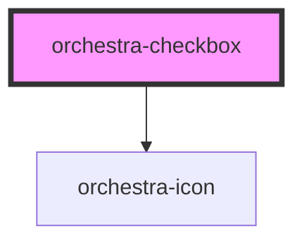

# orchestra-checkbox

<!-- Auto Generated Below -->

## Properties

| Property             | Attribute            | Description                                                                                                                                                                                                             | Type                 | Default                  |
| -------------------- | -------------------- | ----------------------------------------------------------------------------------------------------------------------------------------------------------------------------------------------------------------------- | -------------------- | ------------------------ |
| `ariaDescribedby`    | `aria-describedby`   | ID reference(s) to element(s) that describe this checkbox.                                                                                                                                                              | `string`             | `undefined`              |
| `checked`            | `checked`            | A boolean indicating the checked state of the checkbox.                                                                                                                                                                 | `boolean`            | `false`                  |
| `disabled`           | `disabled`           | A boolean indicating the disable state of the checkbox.                                                                                                                                                                 | `boolean`            | `false`                  |
| `htmlId`             | `html-id`            | The unique identifier for the checkbox input. Used to associate with external label elements.                                                                                                                           | `string`             | `undefined`              |
| `iconLibrary`        | `icon-library`       | The icon library to use for the checkbox indicator.                                                                                                                                                                     | `string`             | `'orchestra-icons'`      |
| `iconNames`          | `icon-names`         | The icon names to use for the checkbox indicator. Accepts an array or a comma-separated string (for example `icon-names="cross,bar"`). The first name is for the checked state, the second for the indeterminate state. | `string \| string[]` | `['checkmark', 'minus']` |
| `indeterminate`      | `indeterminate`      | A boolean indicating the indeterminate state of the checkbox (shows a dash/minus sign). This is part of the native HTML checkbox API for mixed/partial selection states.                                                | `boolean`            | `false`                  |
| `label` _(required)_ | `label`              | Visible label text displayed next to the checkbox. It also provides the checkbox's accessible name.                                                                                                                     | `string`             | `undefined`              |
| `name`               | `name`               | A string representing the name of the checkbox for form submission.                                                                                                                                                     | `string`             | `''`                     |
| `required`           | `required`           | A boolean indicating whether the field is required.                                                                                                                                                                     | `boolean`            | `false`                  |
| `validationMessage`  | `validation-message` | Optional custom validity message. When set to a non-empty string, the field is invalid.                                                                                                                                 | `string`             | `''`                     |
| `value`              | `value`              | A string representing the value of the checkbox for form submission.                                                                                                                                                    | `string`             | `'on'`                   |

## Events

| Event                  | Description                                                              | Type                                |
| ---------------------- | ------------------------------------------------------------------------ | ----------------------------------- |
| `orchestraChange`      | Native change event - emitted when checkbox state changes.               | `CustomEvent<boolean>`              |
| `orchestraStateChange` | Rich state change payload for consumers that need full checkbox context. | `CustomEvent<CheckboxChangeDetail>` |

## Methods

### `checkValidity() => Promise<boolean>`

Checks whether the checkbox satisfies all constraints.

#### Returns

Type: `Promise<boolean>`

### `reportValidity() => Promise<boolean>`

Reports validity and prompts the browser to show the validation UI.

#### Returns

Type: `Promise<boolean>`

### `setCustomValidity(message: string) => Promise<void>`

Sets a custom validity message. Pass an empty string to clear custom errors.

#### Parameters

| Name      | Type     | Description |
| --------- | -------- | ----------- |
| `message` | `string` |             |

#### Returns

Type: `Promise<void>`

## Shadow Parts

| Part          | Description                               |
| ------------- | ----------------------------------------- |
| `"box"`       | The hit area around the control.          |
| `"control"`   | The native checkbox input.                |
| `"error"`     | The container of the `error` slot.        |
| `"icon"`      | The icon inside the indicator.            |
| `"indicator"` | The check or dash drawn over the control. |
| `"label"`     | The visible label text.                   |
| `"row"`       | The wrapper of the control and the label. |

## Dependencies

### Depends on

- [orchestra-icon](../icon)

### Graph

----------------------------------------------

