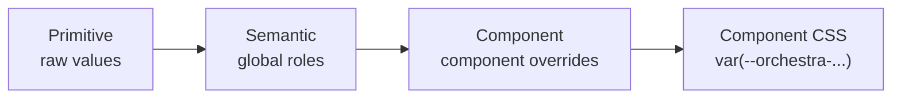
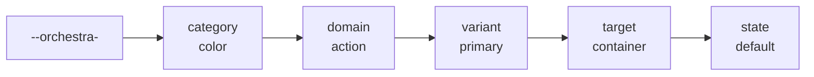
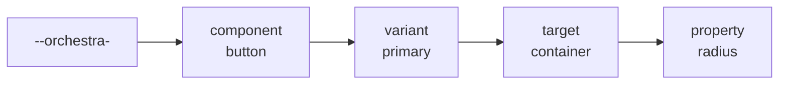

# @orchestra-design-system/themes

Theme entry points for the Orchestra design system.

This package is the public token layer for applications and Storybook. It owns the token source files and generates light and dark CSS bundles. Applications load a theme bundle, and core components consume the resulting CSS custom properties.

## Token model

Orchestra uses a three-tier token structure:



| Tier      | Source file(s)                                       | Purpose                                                           | Exported to CSS?    |
| --------- | ---------------------------------------------------- | ----------------------------------------------------------------- | ------------------- |
| Primitive | `tokens/primitive.json`                              | Raw values                                                        | No (reference only) |
| Semantic  | `tokens/semantic.light.json`, `semantic.dark.json`   | Meaningful values tied to a role or state, referencing primitives | Yes                 |
| Component | `tokens/component.light.json`, `component.dark.json` | Optional overrides for a specific component                       | Yes                 |

This keeps the token system hierarchical and avoids unnecessary duplication: components should use semantic tokens where they express the needed meaning, and use component tokens for component-specific values.

### Resolution trace

A button padding value flows from a primitive through a semantic spacing token and a component token, then is used by the button component.

```jsonc
// 1. tokens/primitive.json — raw value
"scale": { "x2": { "$type": "dimension", "$value": "1rem" } }
```

```jsonc
// 2. tokens/semantic.light.json — meaningful reference to the primitive
"spacing": {
  "action": {
    "primary": {
      "large": {
        "$type": "dimension",
        "$value": "{scale.x2}"
      }
    }
  }
}
```

```jsonc
// 3. tokens/component.light.json — component token references the semantic token
"button": {
  "primary": {
    "container": {
      "padding-inline-start": {
        "$type": "dimension",
        "$value": "{spacing.action.primary.large}"
      }
    }
  }
}
```

```css
/* 4. dist/css/light.css — generated by Style Dictionary */
:root {
  --orchestra-spacing-action-primary-large: 1rem;
  --orchestra-button-primary-container-padding-inline-start: var(
    --orchestra-spacing-action-primary-large
  );
}
```

```css
/* 5. packages/core/src/components/button/button.css — consumed */
.orchestra-button--primary {
  padding-inline-start: var(
    --orchestra-button-primary-container-padding-inline-start
  );
}
```

## Usage

### 1. Import the theme CSS

Applications and Storybook import the generated bundles once, at the app root:

```css
@import '@orchestra-design-system/themes/light.css';
@import '@orchestra-design-system/themes/dark.css';
```

```ts
import '@orchestra-design-system/themes/light.css'
import '@orchestra-design-system/themes/dark.css'
```

Load both bundles to support theme switching. The light bundle defines the default custom properties; the dark bundle provides overrides under `.orchestra-theme--dark`.

### 2. Switch themes

Toggle dark mode by adding the `orchestra-theme--dark` class to any ancestor element (or `<body>` for the whole app):

```html
<!-- Light (default) -->
<orchestra-button>Light Button</orchestra-button>

<!-- Dark -->
<div class="orchestra-theme--dark">
  <orchestra-button>Dark Button</orchestra-button>
</div>
```

### 3. Consume tokens inside components

Component styles should use generated custom properties rather than hardcoding design values. An optional CSS fallback can keep a declaration usable if the theme stylesheet is unavailable; it is a resilience value, not a replacement for defining the design token:

```css
/* packages/core/src/components/button/button.css */
.button--primary {
  background-color: var(--orchestra-color-action-primary-container-default);
  color: var(--orchestra-color-action-primary-content-default);
  border-radius: var(--orchestra-button-primary-container-radius);
}

/* packages/core/src/components/checkbox/checkbox.css */
.checkbox {
  border-radius: var(--orchestra-radius-action-primary-small, 0.25rem);
  border-width: var(--orchestra-size-action-primary-border-width-default, 2px);
}
```

### 4. Naming convention

Each segment classifies what a token is for, so a name can be read without opening the source file. The patterns below show common segments, not a required order: the monitor recognizes allowed roots and later segments, but does not currently enforce later-segment order or require every segment.

#### Categories

| Tier      | Purpose                                     | Exported to CSS | Example                                              |
| --------- | ------------------------------------------- | --------------- | ---------------------------------------------------- |
| Primitive | Raw values that map directly to a value     | No              | `color-purple-500`                                   |
| Semantic  | Global UI roles shared across components    | Yes             | `--orchestra-color-action-primary-container-default` |
| Component | Values used only by one component's own CSS | Yes             | `--orchestra-button-primary-container-radius`        |

#### Semantic anatomy



Example: `--orchestra-color-action-primary-container-default`. Other valid names may omit segments or arrange later segments differently.

#### Component anatomy



Example: `--orchestra-button-primary-container-radius`. Static properties do not need a state segment.

#### Segments

| Segment     | Tier                | Meaning                                                 | Values                                                                                                                                                           |
| ----------- | ------------------- | ------------------------------------------------------- | ---------------------------------------------------------------------------------------------------------------------------------------------------------------- |
| `orchestra` | All exported tokens | Fixed prefix that namespaces every CSS variable         | Added during CSS generation                                                                                                                                      |
| `category`  | Semantic            | Kind of design value                                    | `color`, `spacing`, `radius`, `size`                                                                                                                             |
| `component` | Component           | Component the token belongs to                          | `button`, `checkbox`                                                                                                                                             |
| `domain`    | Semantic            | Functional area                                         | `global`, `neutral`, `action`, `selection`, `edition`                                                                                                            |
| `variant`   | Semantic, component | Visual variant or role; one per token                   | `primary`, `secondary`, `tertiary`, `brand`, `inline`, `common`, `toggle`                                                                                        |
| `target`    | Semantic, component | Part of the component or pattern the token styles       | `container`, `content`, `border`, `size`, `inner-ring`, `outer-ring`                                                                                             |
| `property`  | Semantic, component | Style being configured, usually matching a CSS property | `radius`, `border-width`, `padding`, `padding-inline-start`, `padding-inline-end`, `padding-block-start`, `padding-block-end`, `gap`, `width`, `height`, `color` |
| `state`     | Semantic, component | Interaction state, or a size or toggle modifier         | `default`, `hover`, `active`, `focus`, `disabled`, `readonly`, `highlight`, `on`, `off`, `small`, `medium`, `large`                                              |

The primitive tier uses `category` (`color` or `scale`), `family` (for example `purple`, `grey`, `blue`) and `step` (a number such as `500`, `x2`, `x2-5`, or `none`, `full`, `transparent`).

#### Naming rules

- Use lowercase kebab-case throughout. Separate segments with a dash, and join multi-word values with a dash too, as in `border-width` or `inner-ring`.
- Use one variant per token.
- Use `default` as the base state. Use `hover`, `active`, `focus` and `disabled` for interaction states, and `small`, `medium` or `large` for size modifiers at the end of the name.
- Follow the order in the anatomy diagrams as the common pattern. The monitor does not enforce later-segment order or require every segment; allowed roots and segments are configured in `monitoring.mjs`.

Only semantic and component tokens are exported to CSS; primitives are referenced internally and filtered out during generation.

### Design token rules

#### Rules the monitor can check

- Primitive tokens must start with a recognized category root (`color` or `scale`); semantic tokens with a category root (`color`, `spacing`, `radius`, or `size`); component tokens with a component root (currently `button` or `checkbox`).
- Later name segments must match a configured word or pattern. Names use lowercase, kebab-case segments, and generated CSS names are prefixed with `--orchestra-`.
- Semantic and component tokens must have a matching token path in both light and dark themes. Their values may differ.
- A token must not alias another token in the same tier.

The monitor does not enforce the order of later name segments or require every naming column to appear. The allowed roots and segments are configured in `PRIMITIVE_COLUMNS`, `SEMANTIC_COLUMNS`, and `COMPONENT_COLUMNS` in `monitoring.mjs`.

#### Rules that need design judgment

- Add a component token only when it expresses a component-specific role or provides an intentional independent configuration point. Do not add one solely because it might be useful later.
- If a semantic token already communicates the intended meaning and supports the system's needs, use it directly rather than creating a component token that only aliases it.
- Consider whether components need to vary independently. For example, a button may need distinct inline and block padding while a checkbox uses uniform padding. A component token is justified when that distinction is real and should be configurable without changing other components.

The monitor can show token aliases and usage, but it cannot decide whether an independent override is a genuine design requirement. Treat this as a human review, not an automated violation.

## Build

```bash
npm run build
```

The build writes the light and dark theme stylesheets to `dist/css/light.css` and `dist/css/dark.css`.

### Design tokens monitoring

Run the monitor after the build to generate `monitoring/design-tokens-monitoring.html`:

```bash
npm run monitoring
```

The page is rendered from the template in `monitoring/template/design-tokens-monitoring.template.html`. Its styles use the generated Orchestra tokens, loaded from `../dist/css/light.css`. The title is set by `PAGE_TITLE` in `monitoring.mjs`. The page has one section per level: Primitive, Semantic and Component. It reports unrecognized name segments, same-layer aliases, and semantic or component tokens missing from one of the themes. Each section has an advice table when issues are present.

- The Used by column lists the tokens that alias each token through a `{...}` reference, and the component folders in `packages/core/src/components` that reference it with `var(...)`, prefixed with `component:`. For primitives, this shows which semantic tokens use them.
- A token whose value aliases another token in the same level through a `{...}` reference is listed in the Issues column as a same-layer token. Rows with no issues leave that column empty.
- Primitives are not emitted to CSS, so they show a single raw value column.
- Semantic and component tokens should have values in both light and dark themes.
- The monitor checks root words and whether later segments match the configured allowed words or patterns; it does not enforce their order or require every column to be present.
- Primitive, Semantic and Component each have separate naming configurations in `PRIMITIVE_COLUMNS`, `SEMANTIC_COLUMNS`, and `COMPONENT_COLUMNS` in `monitoring.mjs`. Semantic and component columns share later-segment classifications, but have distinct roots. Update the corresponding list when a convention changes.

## Notes

- Token sources live in `tokens/`.
- CSS generation is handled by Style Dictionary.
- The monitoring page is generated by `monitoring.mjs` from `monitoring/template/design-tokens-monitoring.template.html`. Edit the template or `monitoring.mjs`, not the generated page.
- The core package consumes these variables, rather than owning the generated theme CSS itself.
- The public theme package is the recommended entry point for applications and Storybook.
